# Clean, transform, and load data in Power BI
---
## Lab story

## Get started with Power BI Desktop

Descargar: https://github.com/MicrosoftLearning/PL-300-Microsoft-Power-BI-Data-Analyst/raw/Main/Allfiles/Labs/02-transform-data-power-bi/02-transform-data.zip

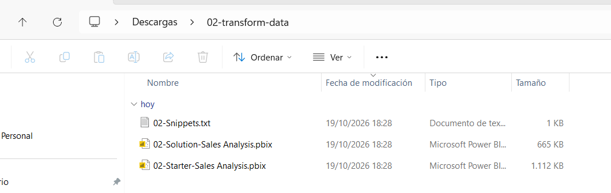

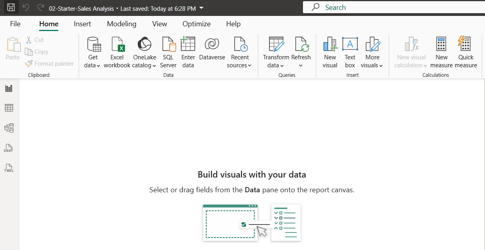

## Configure the Salesperson query

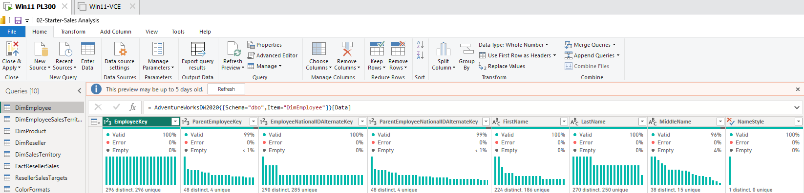

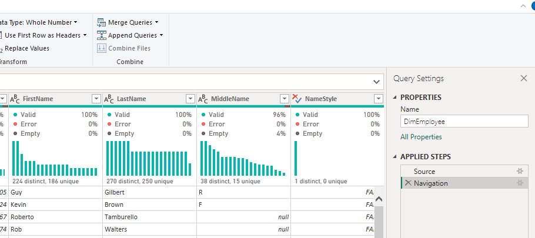

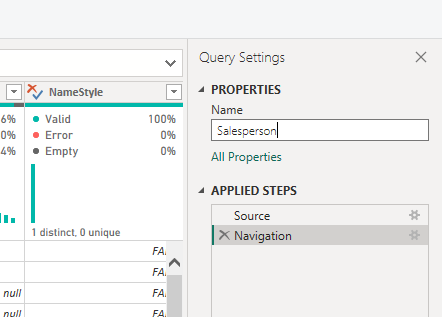

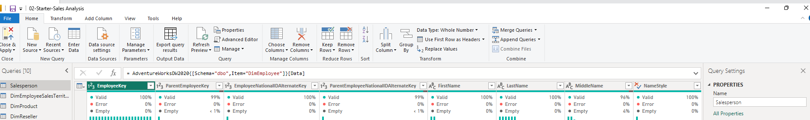

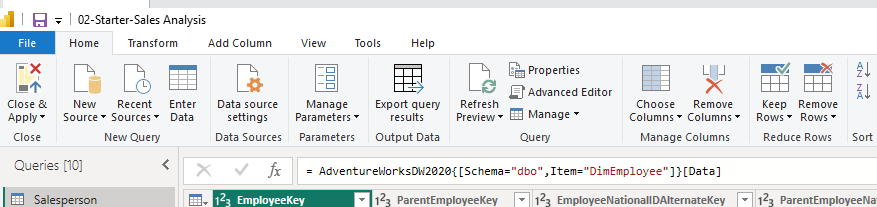

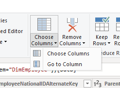

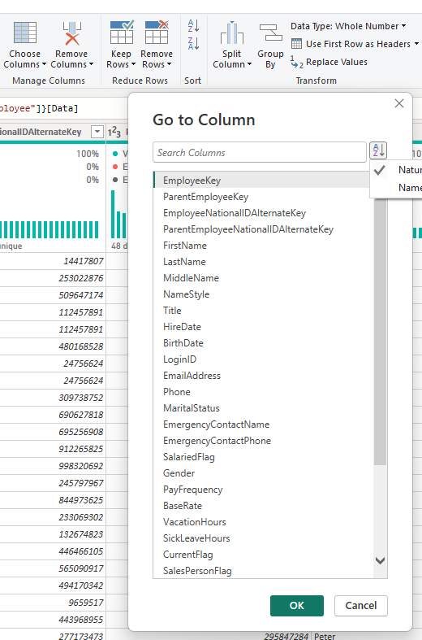

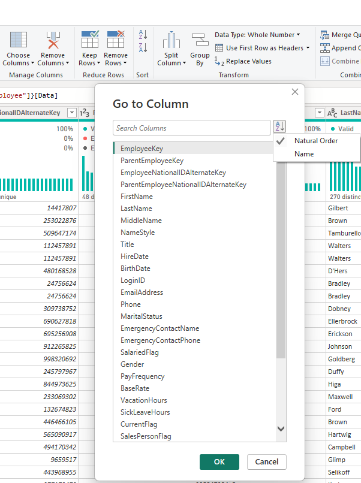

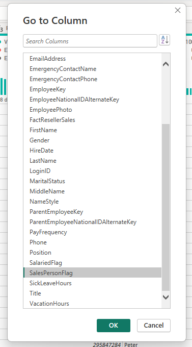

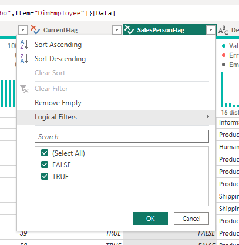

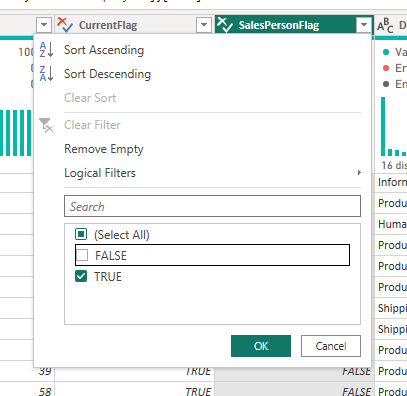

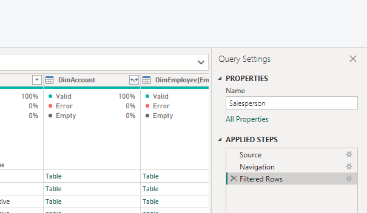

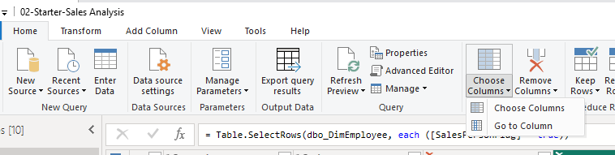

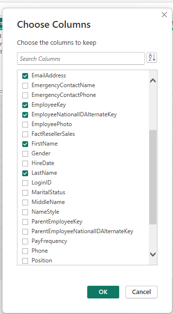

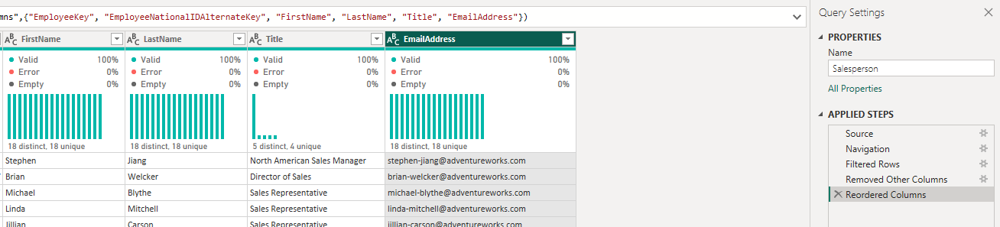

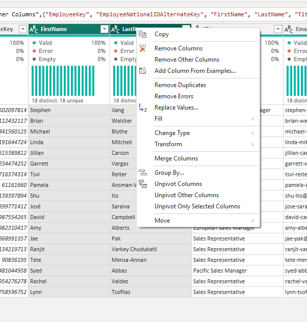

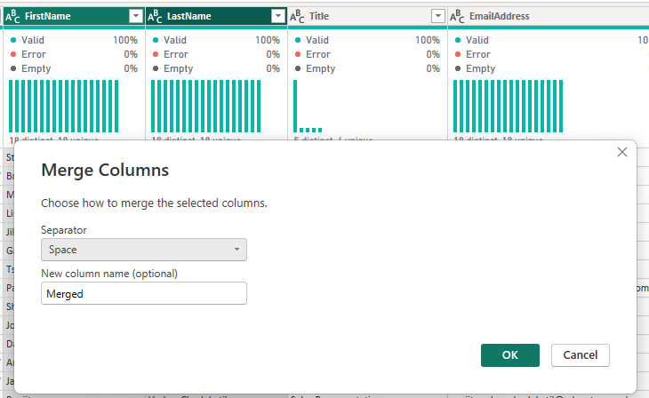

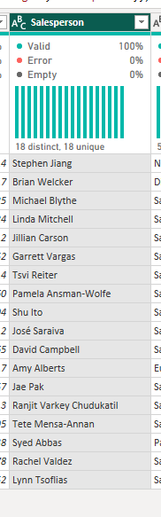

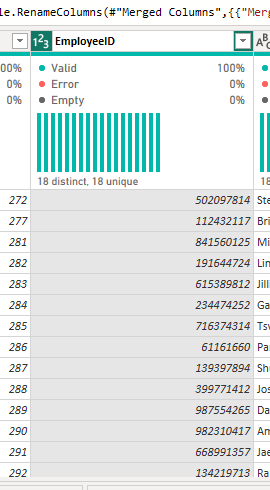

** In the status bar at the bottom-left corner of the Power Query Editor, verify that the query has 5 columns and 18 rows.

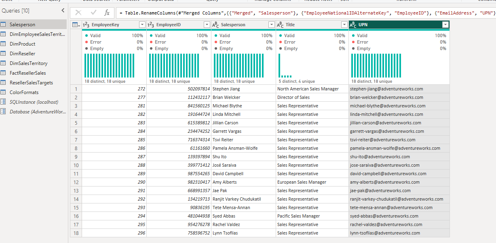

---
---

## Configure the SalespersonRegion query

In this task, you’ll configure the SalespersonRegion query.

---
---

---
---
## Get data from a CSV file

---
---
## Lab complete

