# Use DAX time intelligence functions in Power BI
---
## Lab story

## Get started

Descargar: https://github.com/MicrosoftLearning/PL-300-Microsoft-Power-BI-Data-Analyst/raw/Main/Allfiles/Labs/06-use-dax-time-intelligence/06-time-intelligence.zip

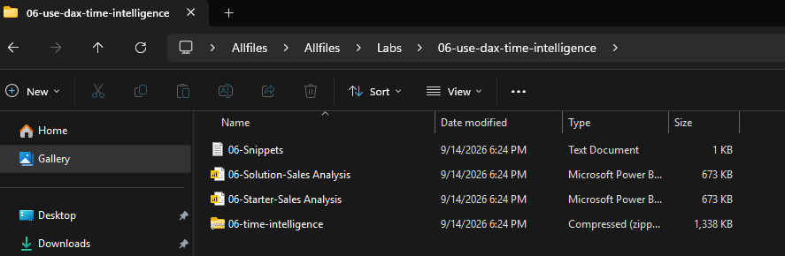

---

Abrir: 06-Starter-Sales Analysis.pbix
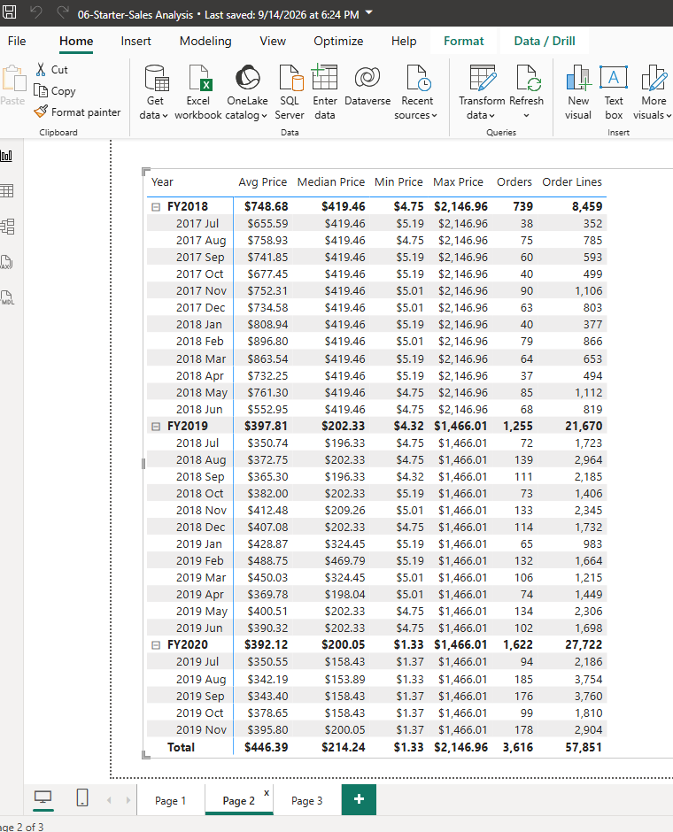

---
---
## Create a YTD measure
En este ejercicio vas a calcular las ventas acumuladas del año fiscal utilizando la función TOTALYTD.

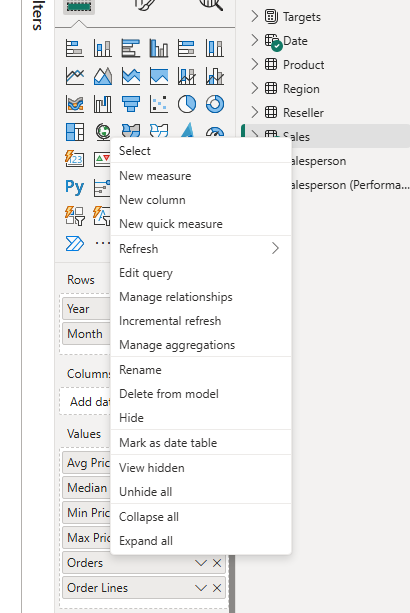

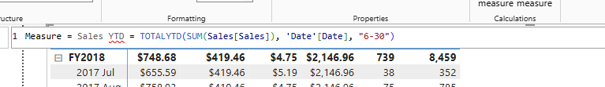

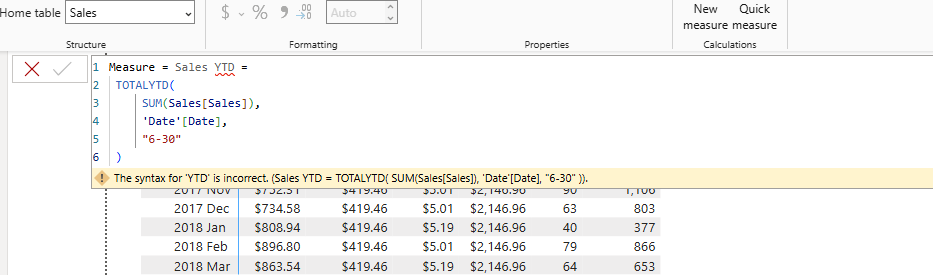

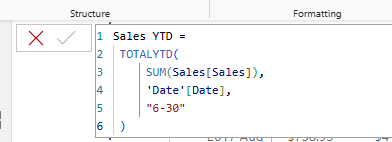

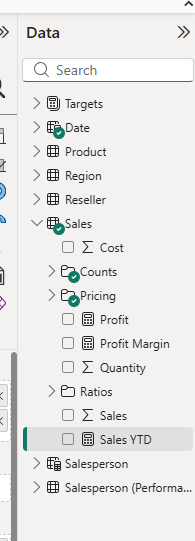

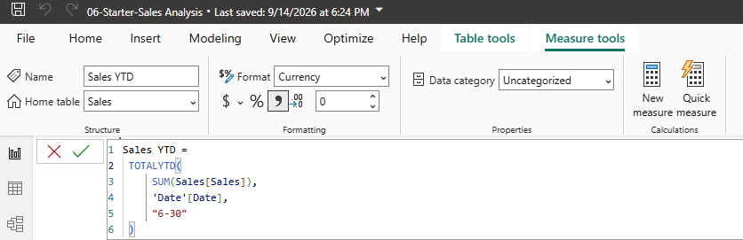

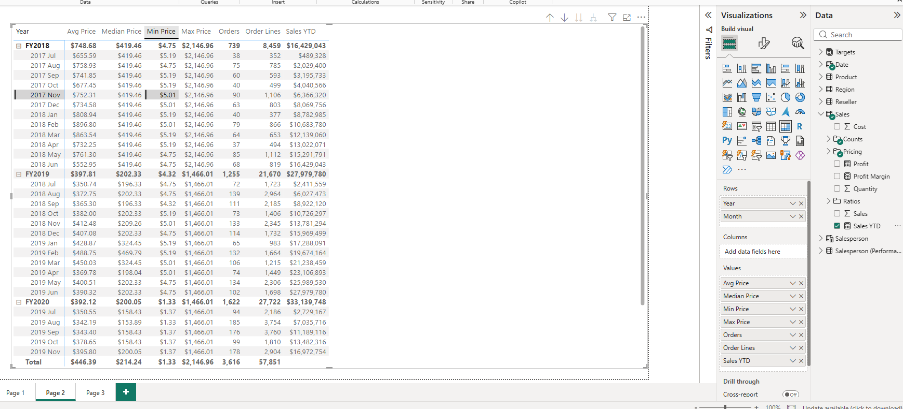

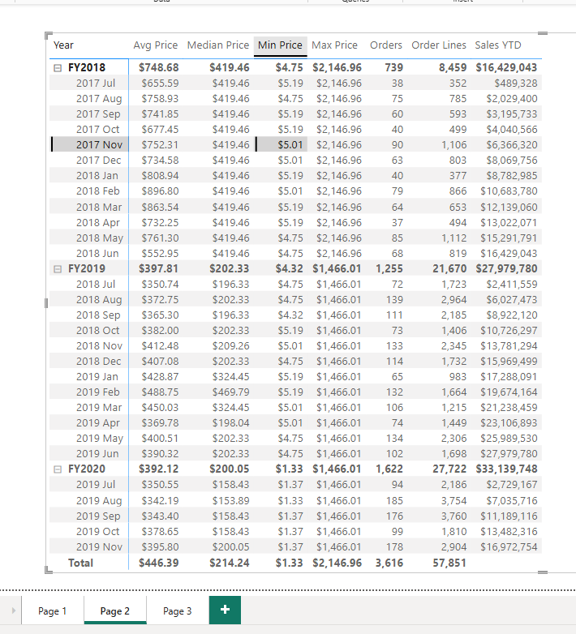

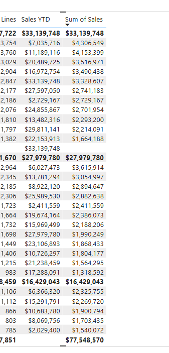

---
---

## Create a YoY growth measure

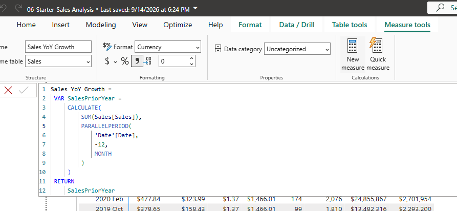

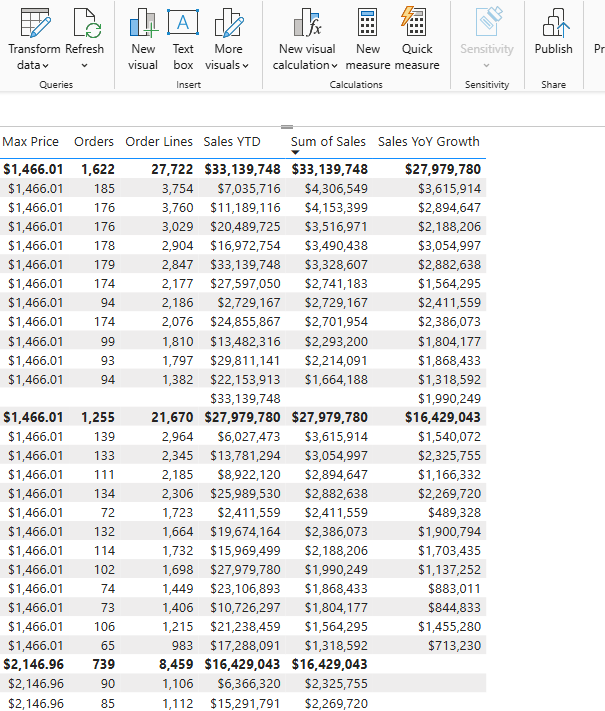

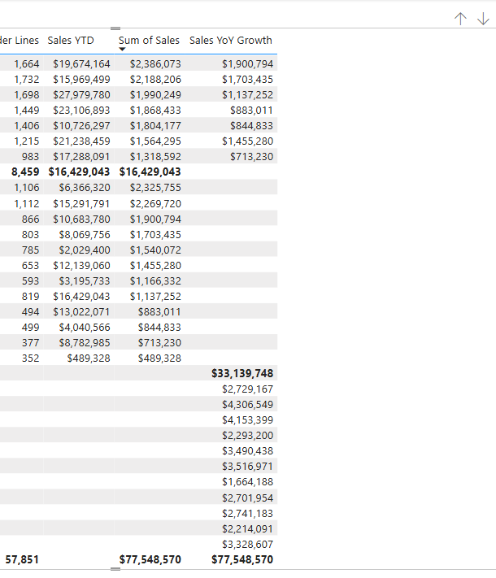

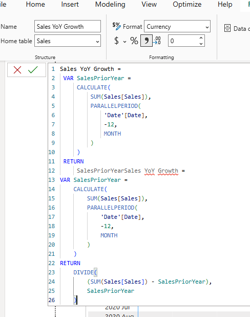

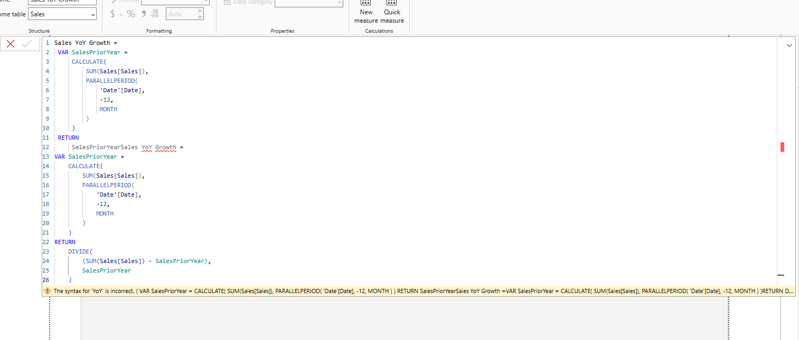

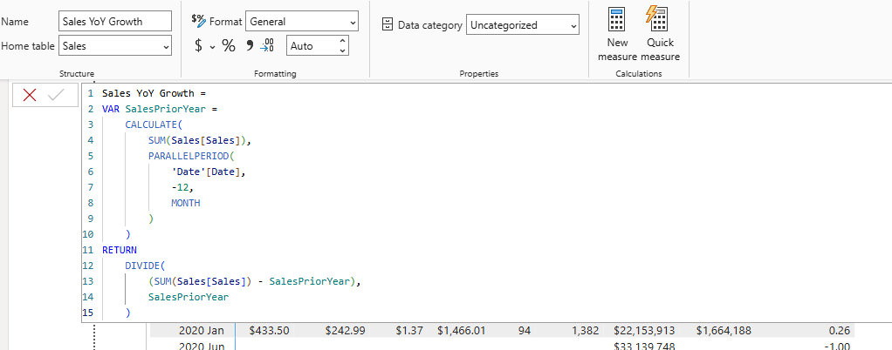

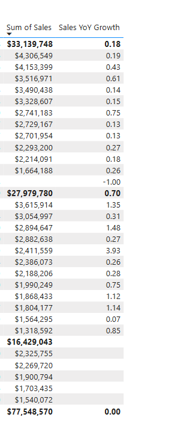

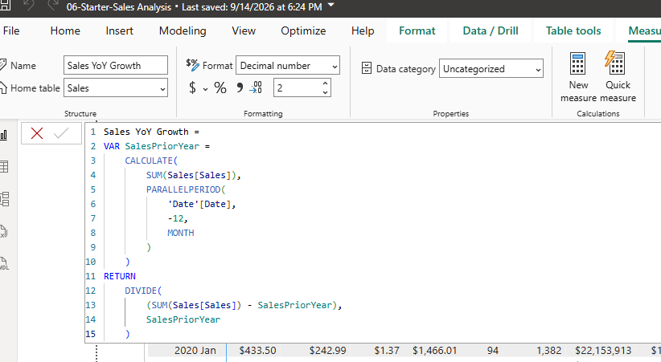

---
---
In Model view, place the two new measures into a display folder named Time intelligence.

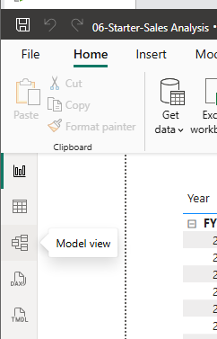

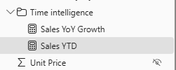

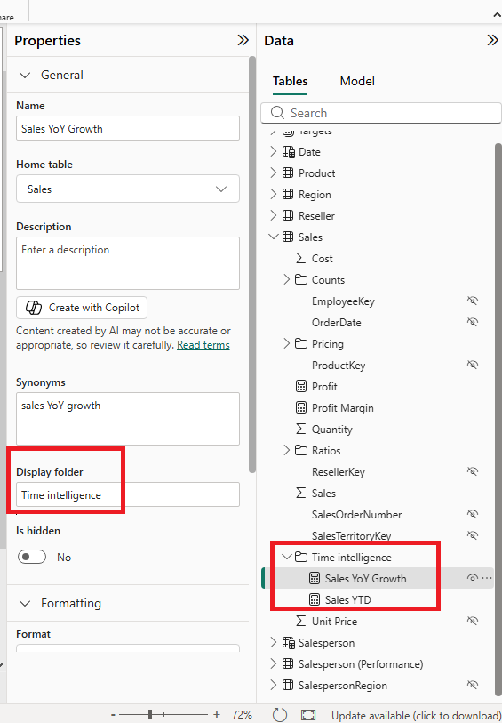

---
---

///////

## LAB COMPLETE
---
---

