# Get data in Power BI
---
## Lab story

## Get started with Power BI Desktop
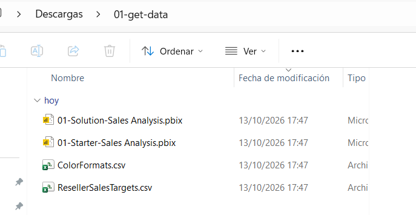
## Get data from SQL Server
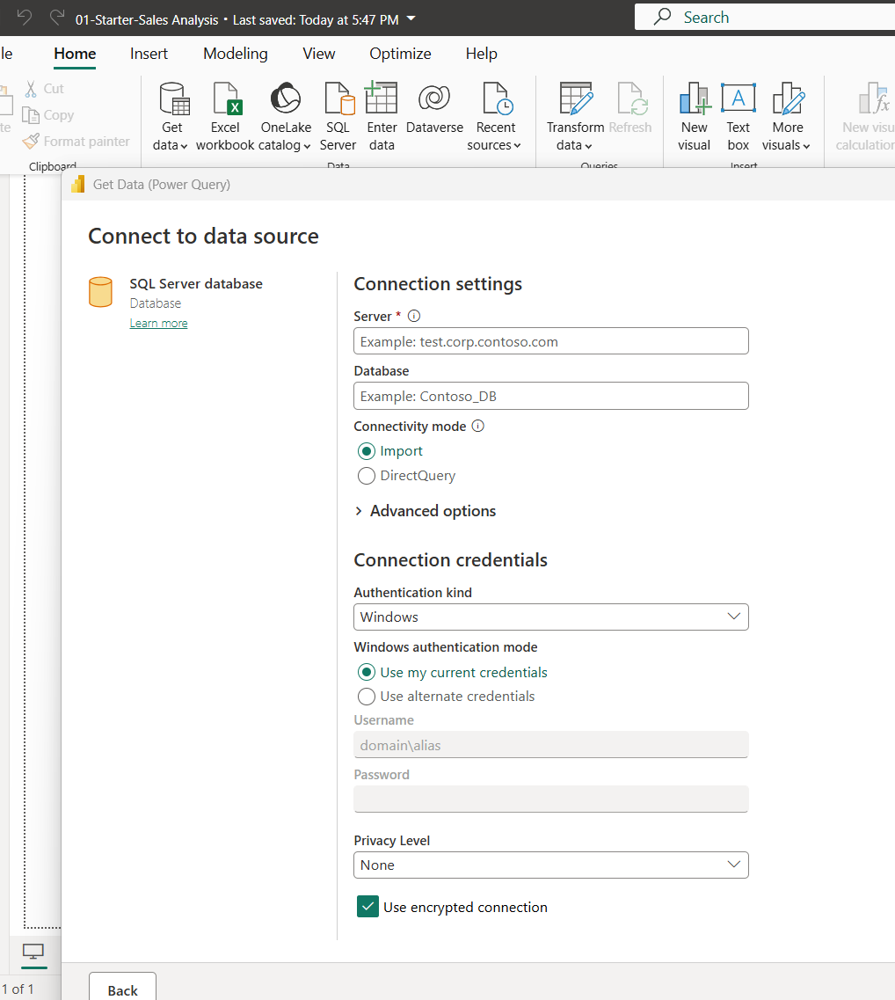
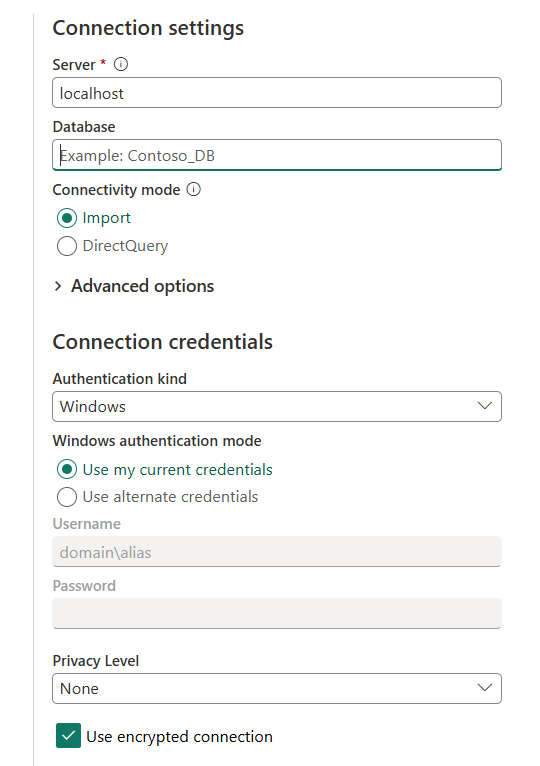
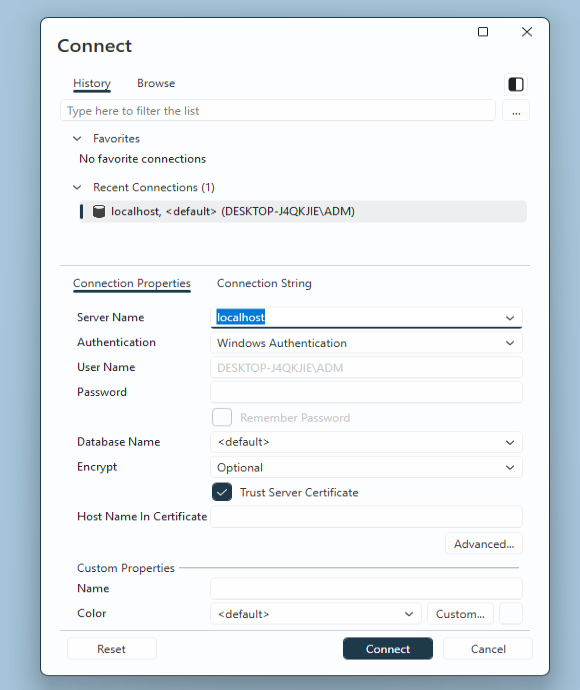
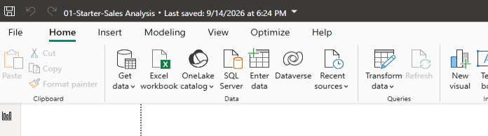

---
## Preview Data in Power Query Editor
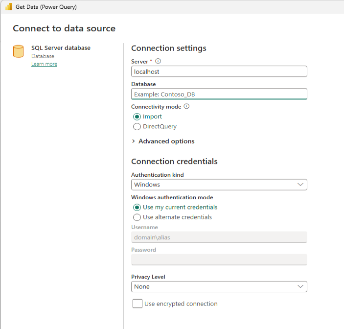
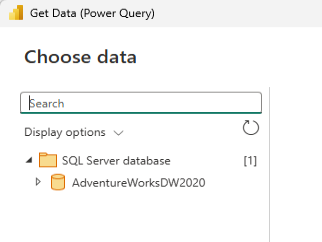
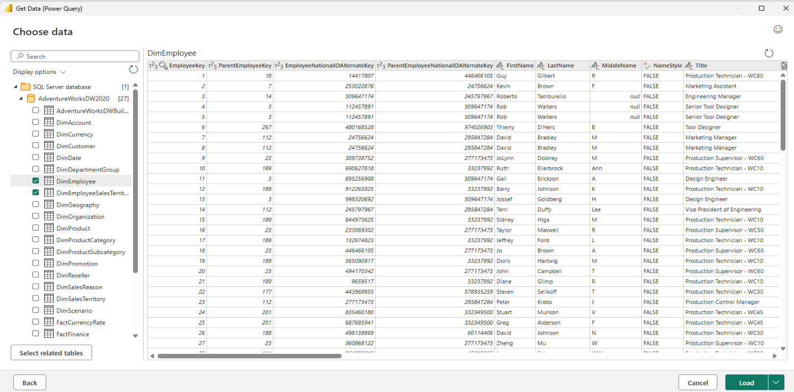
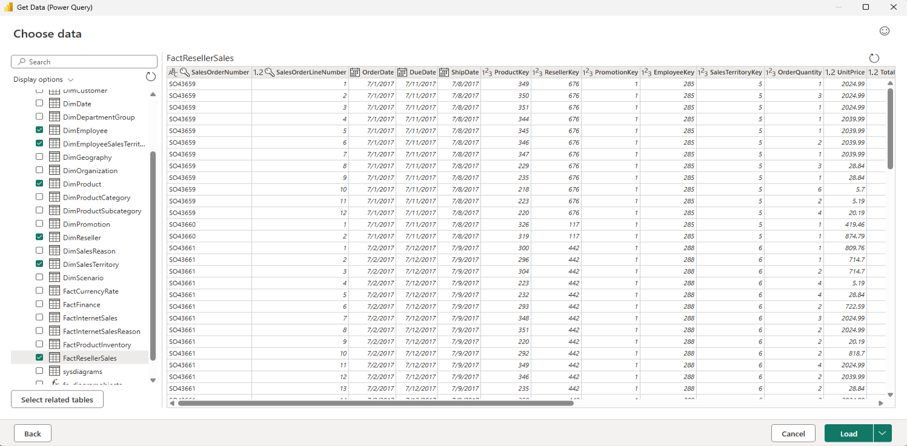
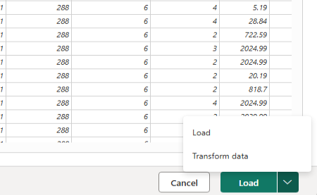
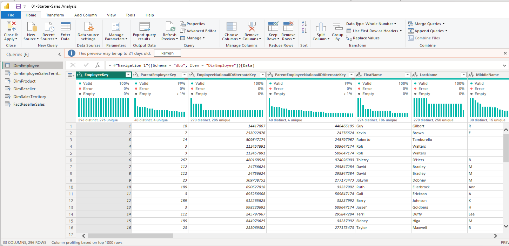

---
## Get data from a CSV file

## Lab complete
